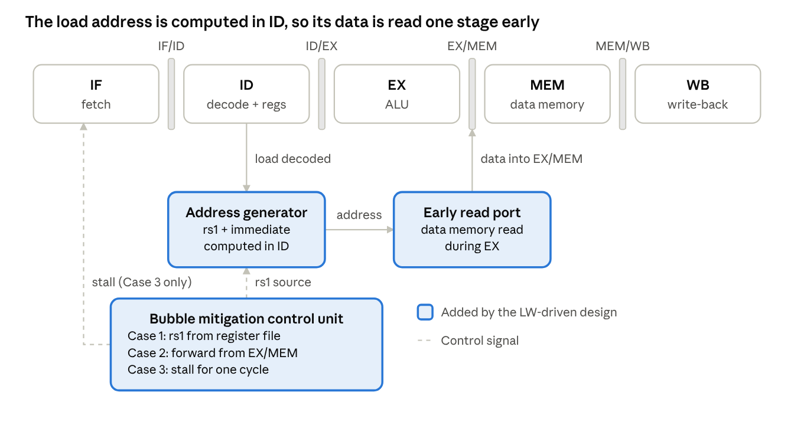
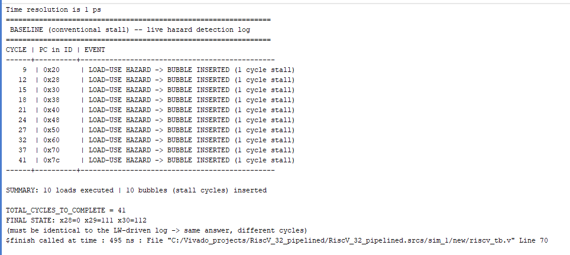
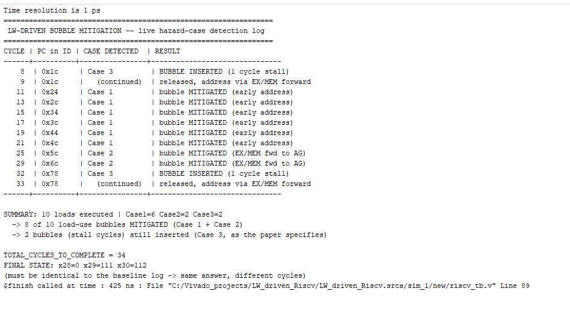
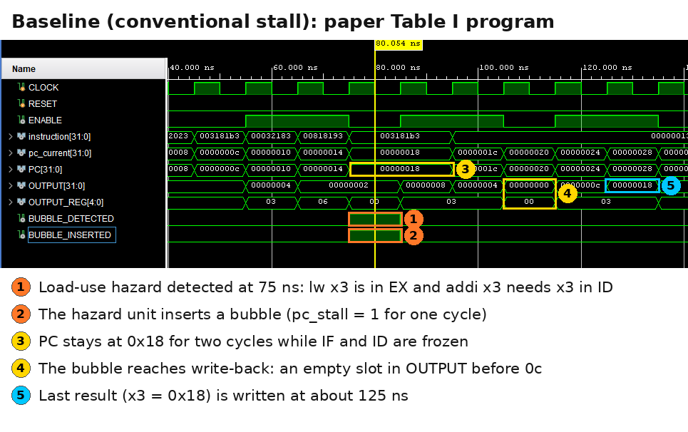
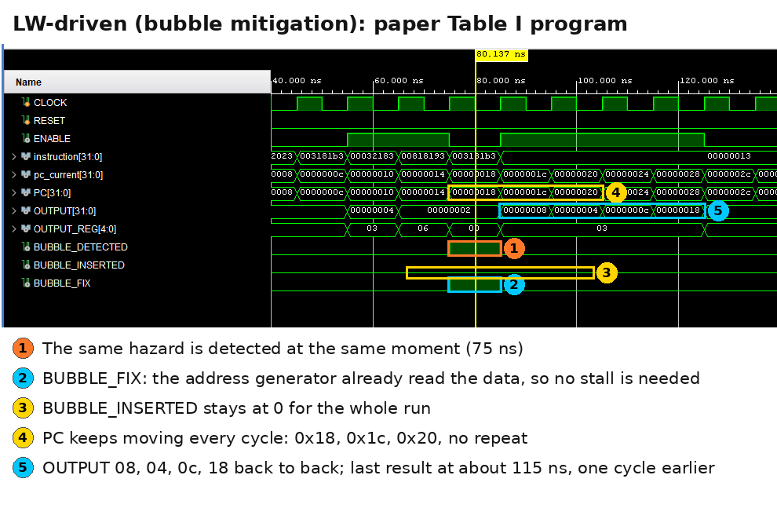
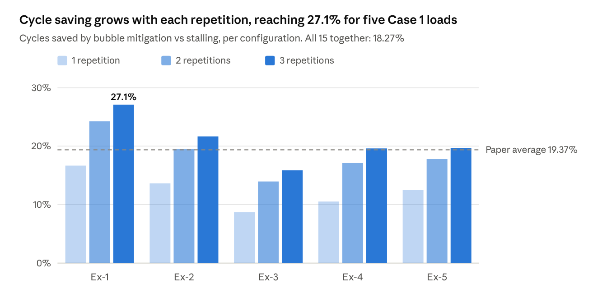
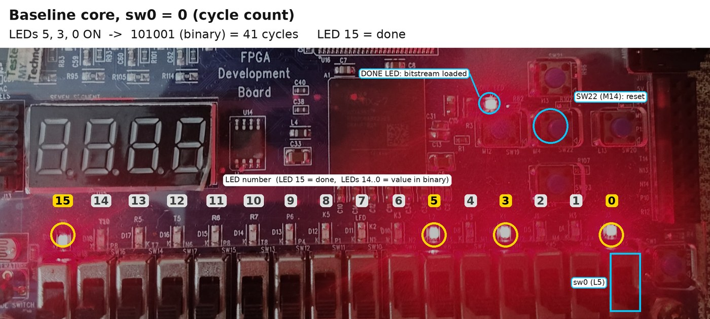
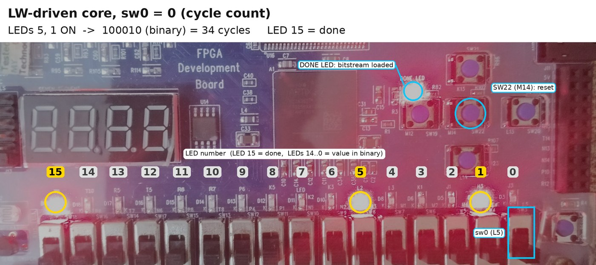
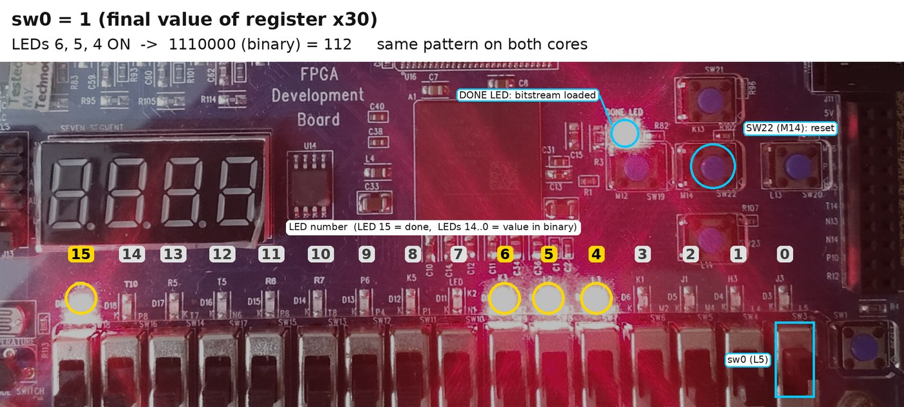

# LW-Driven Bubble-Free RV32I RISC-V Processor

An implementation of the load-word (LW) driven bubble mitigation technique from Kumar and Ray, *"Micro-Architecture of LW Driven Bubble-Free Five-Stage Pipelined RISC-V Processor Core for Energy Constraint Low-End Application"* (IEEE Transactions on Circuits and Systems I, January 2026).

Two five-stage RV32I cores are built from the same base code: a conventional core that stalls on every load-use hazard, and a core with the paper's address generator and bubble mitigation control unit. Both are verified in simulation and run on an Artix-7 FPGA (EDGE Artix-7 kit, XC7A35T-FTG256).

**Author:** Loka Veera Sesha Sai Teja Gantasala, B.Tech ECE, IIIT Sri City

**Tools:** Verilog HDL, Xilinx Vivado 2025.2, Icarus Verilog, EDGE Artix-7 FPGA board (XC7A35T-FTG256)

**Full project report:** [docs/LW_Driven_RV32I_Project_Report.pdf](docs/LW_Driven_RV32I_Project_Report.pdf)

## Results at a glance

| Metric | Baseline (stall) | LW-driven (bubble-free) | Change |
| --- | --- | --- | --- |
| Bubbles on the 10-load program | 10 | 2 | -80% |
| Cycles, 10-load program, simulation | 41 | 34 | -17.1% |
| Cycles, 10-load program, on the FPGA | 41 | 34 | -17.1% |
| Total cycles, 45-program Table III-style sweep | 591 | 483 | -18.3% |
| Final register state (x28, x29, x30) | 0, 111, 112 | 0, 111, 112 | identical |
| LUTs + registers | 2076 | 2330 | +12.2% |
| Max frequency (MHz, speed grade -3) | 160.8 | 152.5 | -5.2% |
| Dynamic power (mW, Vivado estimate) | 22 | 19 | -13.6% |
| Dynamic energy for the 10-load program (nJ) | 9.0 | 6.5 | -28.4% |

The paper reports a 19.37% average cycle improvement and an 11.4% area increase. This implementation measured 18.27% and 12.2%.

## How the technique works

In a normal five-stage pipeline a load computes its address in EX and reads memory in MEM, so an instruction that needs the loaded value straight away has to wait one cycle (a bubble). The LW-driven core computes the load address one stage earlier, in ID, and reads memory during EX. The data is ready one cycle sooner and the bubble disappears.



The bubble mitigation control unit (`bubble_ctrl.v`) sorts every load by where its base register rs1 comes from:

| Case | Where rs1 comes from | What happens | Bubble |
| --- | --- | --- | --- |
| Case 1 | Already in the register file | Address computed directly in ID | none |
| Case 2 | Instruction two ahead (in EX/MEM) | rs1 forwarded from EX/MEM into the address generator | none |
| Case 3 | Instruction directly ahead (still in EX) | Value not ready yet, load held for one cycle | 1 cycle |

## Simulation results

**Bubble detection on the 10-load program.** The baseline inserts a bubble for all 10 loads. The LW-driven core classifies them as 6 Case 1, 2 Case 2 and 2 Case 3, and stalls only for the two Case 3 loads.

| Baseline | LW-driven |
| --- | --- |
|  |  |

**The paper's Table I program.** Both cores detect the same hazard at 75 ns. The baseline inserts a bubble and the PC holds at 0x18; the LW-driven core fixes it with no stall and finishes one cycle earlier.





**Table III-style sweep.** Five hazard mixes (Ex-1 to Ex-5), each repeated 1, 2 and 3 times. The saving grows with repetition and is smallest for the mixes that contain a Case 3 load.

| Mix | Case 1 loads | Case 2 loads | Case 3 loads |
| --- | --- | --- | --- |
| Ex-1 | 5 | 0 | 0 |
| Ex-2 | 3 | 2 | 0 |
| Ex-3 | 2 | 2 | 1 |
| Ex-4 | 4 | 0 | 1 |
| Ex-5 | 2 | 3 | 0 |



## FPGA verification

A small wrapper (`fpga/fpga_top.v`) counts cycles from reset until the program ends and shows the result on the 16 LEDs in binary. Switch sw0 picks the cycle count (sw0 = 0) or register x30 (sw0 = 1); LED 15 means the result is ready. The centre push button (SW22) resets the core.

| LED | 0 | 1 | 2 | 3 | 4 | 5 | 6 | 7 | 8 to 14 | 15 |
| --- | --- | --- | --- | --- | --- | --- | --- | --- | --- | --- |
| Pin | J3 | H3 | J1 | K1 | L3 | L2 | K3 | K2 | K5, P6, R7, R6, T5, R5, T10 | T9 |
| Weight | 1 | 2 | 4 | 8 | 16 | 32 | 64 | 128 | 256 to 16384 | done |

Baseline, sw0 = 0: LEDs 5, 3, 0 on, so 32 + 8 + 1 = **41 cycles**.



LW-driven, sw0 = 0: LEDs 5, 1 on, so 32 + 2 = **34 cycles**.



sw0 = 1: LEDs 6, 5, 4 on, so 64 + 32 + 16 = **x30 = 112**, the same on both cores.



The unannotated photos are in `images/fpga/`. The board's oscillator is 50 MHz; the constraint file uses a stricter 10 ns clock.

## Area, timing and power

From the routed designs in Vivado 2025.2 (xc7a35tftg256-3, 10 ns constraint). Report screenshots are in `images/vivado/`.

| Parameter | Baseline | LW-driven | Change | Paper's change |
| --- | --- | --- | --- | --- |
| Slice LUTs (logic + distributed RAM) | 796 + 0 | 772 + 256 | +29.1% | |
| Block RAM (RAMB18) | 1 | 0 | -1 | |
| Slice registers | 1280 | 1302 | +1.7% | |
| LUTs + registers | 2076 | 2330 | +12.2% | +11.4% |
| WNS at 10 ns (ns) | 3.782 | 3.441 | | |
| Max delay (ns) | 6.218 | 6.559 | +5.5% | +3.2% |
| Max frequency (MHz) | 160.8 | 152.5 | -5.2% | -3.0% |
| Dynamic power (mW) | 22 | 19 | -13.6% | -5.8% |

Most of the extra area comes from the data memory: the second read port needed by the early load moved it from a block RAM into 256 LUTs of distributed RAM. Power figures are Vivado vectorless estimates (medium confidence).

## Repository layout

```
rtl/baseline/     conventional 5-stage RV32I core (13 modules)
rtl/lw_driven/    same core + bubble_ctrl.v and the bubble mitigation changes
fpga/             fpga_top.v (cycle counter, LED display) and fpga_top.xdc (pins)
sim/programs/     instructions_10load.mem, instructions_paper_table1.mem
sim/testbenches/  bubble-detection logs, paper-style waveforms, FPGA wrapper check
sim/run_all.sh    runs every simulation with Icarus Verilog
sweep/            Table III-style sweep: gen.py, tb_sweep.v, run_sweep.py, results.json
images/           waveforms, console logs, board photos, Vivado reports, figures
docs/             project report (PDF)
```

### Modules

| Module (file) | Stage | What it does | Change in the LW-driven core |
| --- | --- | --- | --- |
| pc (pc.v) | IF | Program counter | none |
| instr_mem (instr_mem.v) | IF | 256-word instruction ROM | none |
| if_stage (if_stage.v) | IF | IF/ID register | none |
| register_file (reg_file.v) | ID, WB | 32 x 32-bit registers | none |
| id_stage (id_stage.v) | ID | Decoder, immediate, ID/EX register | sends opcode and immediate to the address generator; carries the early address |
| bubble_ctrl (bubble_ctrl.v) | ID | Address generator and bubble mitigation control unit | new module |
| hazard_unit (hazard_unit.v) | ID | Stall and flush control | stalls only for Case 3 |
| ex_stage, alu | EX | Forwarding muxes, ALU, EX/MEM register | mux for the early-read data |
| forwarding_unit | EX | EX/MEM and MEM/WB forwarding | none |
| mem_stage | MEM | Data memory access, branches, MEM/WB register | none |
| data_mem (data_mem.v) | MEM | 256-word data memory | second read port |
| wb_stage (wb_sage.v) | WB | Write-back select | none |
| riscv_top (riscv_top.v) | top | Connects the modules | bubble_ctrl wired in |

## Running it

**Icarus Verilog** (Linux, macOS or WSL):

```
./sim/run_all.sh            # bubble logs, paper waveforms, FPGA wrapper check
python3 sweep/run_sweep.py  # full 45-program sweep
```

**Vivado:** make one project per core. Add `rtl/<core>/*.v` and `fpga/fpga_top.v` as design sources, `fpga/fpga_top.xdc` as a constraint, and one testbench from `sim/testbenches/` as the simulation source. Copy the matching program from `sim/programs/` into the project as `instructions.mem` (the 10-load program for the bubble logs and the FPGA, the Table I program for the waveforms). For synthesis the 10-load program is already built into `instr_mem.v`, so no file path is needed. Set `fpga_top` as top, generate the bitstream and program the board.

## Fixes and known issues

Besides the bubble mitigation work, both cores have these fixes:

- **Register file write-through.** A register read in ID in the same cycle it was written in WB returned the old value. Fixed with a bypass in `reg_file.v`.
- **Instruction ROM for synthesis.** `$readmemh` with a relative path is not found during Vivado synthesis, which silently gives an empty ROM. `instr_mem.v` now builds the test program in for synthesis and still reads `instructions.mem` in simulation.
- **Debug outputs.** `riscv_top` exposes the PC and register x30 to the FPGA wrapper.

Three known issues remain in the pipeline and are worked around rather than fixed: branches ignore funct3 (every branch behaves like `beq`), `jal` is not decoded, and a taken branch flushes only two of the three wrong-path instructions. The sweep therefore uses unrolled loops instead of branches.

## Acknowledgement

The base five-stage RV32I pipeline is adapted from [Saravana Kumar T J A's open-source core](https://github.com/saravana-kumar-T-J-A/32-bit-Risc-V-processor-core).

## Reference

Kumar and Ray, "Micro-Architecture of LW Driven Bubble-Free Five-Stage Pipelined RISC-V Processor Core for Energy Constraint Low-End Application," *IEEE Transactions on Circuits and Systems I: Regular Papers*, January 2026.
